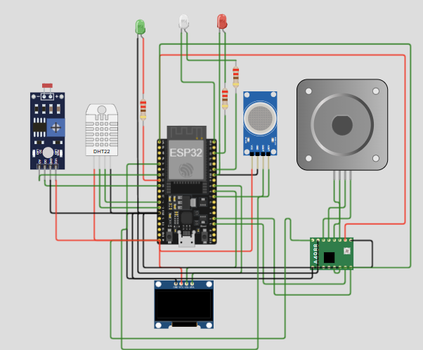

# Smart Fire Monitoring & Automated Door System (IoT Simulation)

This project is an IoT simulation built with ESP32, designed to monitor environmental parameters (temperature, gas, light) and automatically trigger safety protocols such as opening a ventilation door when dangerous thresholds are exceeded. It synchronizes real-time data and remote control commands via Firebase.

## 🔌 Circuit Diagram

## 🛠 Hardware Components
- **Microcontroller:** ESP32 DevKit V4
- **Sensors:** DHT22 (Temperature & Humidity), MQ Gas Sensor, Photoresistor/LDR Module
- **Actuators:** Stepper Motor with A4988 Driver, 3x LEDs (Red, Green, White)
- **Display:** OLED SSD1306 (128x64) via I2C

## ⚙️ Pin Configuration
- **DHT22:** GPIO 12
- **MQ Gas Sensor:** Analog GPIO 34
- **LDR Module:** Analog GPIO 32, Digital GPIO 25
- **Stepper Motor (A4988):** STEP GPIO 15, DIR GPIO 2
- **OLED Display:** SDA GPIO 18, SCL GPIO 5
- **LED Indicators:** Green (GPIO 33), Red (GPIO 22), White (GPIO 21)

## 📚 Required Libraries
Ensure the following libraries are installed in your environment (Arduino IDE or Wokwi):
- `DHT sensor library`
- `Adafruit GFX Library`
- `SSD1306Ascii`
- `dhtESP32-rmt`

## 🚀 Setup & Configuration
1. **Network Credentials:** Open the source code and update `ssid` and `password` variables to match your local WiFi or simulator settings.
2. **Database Connection:** Replace the `firebaseURL` variable with your own Firebase Realtime Database URL.
3. **Database Rules:** Ensure your Firebase rules allow `GET` and `PUT` requests for paths `/sensor.json` and `/control.json`.
4. **Deploy:** Upload the code to your ESP32 board or run the simulation directly in Wokwi.

## 📊 Core Features
- **Real-Time OLED Interface:** Displays current temperature, humidity, gas levels, threshold limits, and system status directly on the screen.
- **Safety Automation:** Continuously evaluates sensor data against dynamic limits (`gasLimit`, `tempLimit`). If breached, it switches status to "DANGER", activates the Red LED, and rotates the Stepper Motor to simulate opening an emergency door.
- **Smart Lighting:** Automatically illuminates the White LED when ambient light is low (LDR digital low), or can be overridden remotely via Firebase.
- **Cloud Telemetry:** Pushes sensor states, system status, and calculation latencies (in milliseconds) to Firebase every second, while checking for updated remote control commands.
